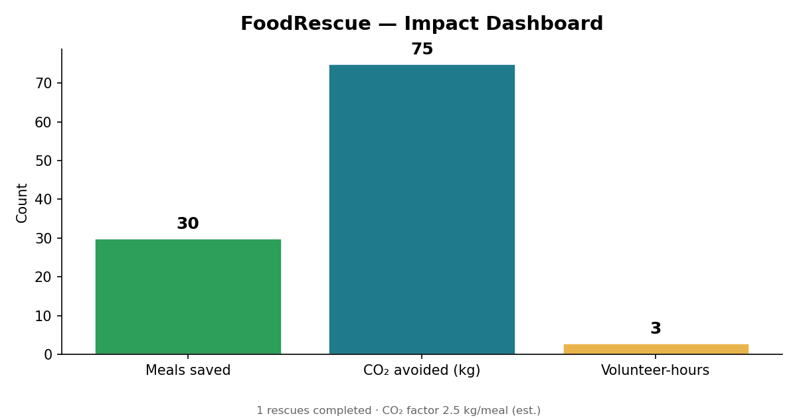
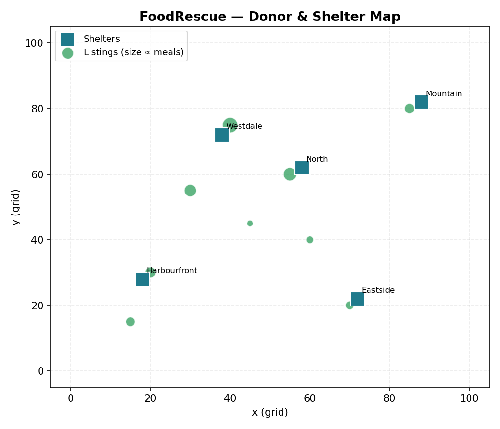

# 🍲 FoodRescue


**Match surplus food with shelters before it expires.**

## The Problem

Every night, restaurants throw away perfectly edible food — while a few blocks away, shelters turn people away for lack of meals. The food exists. The need exists. What's missing is **matching**: getting the right food to the right shelter *before the clock runs out*, respecting dietary needs (halal, veg, gluten-free) and distance.

This is [UN SDG 2](https://sdgs.un.org/goals/goal2) (Zero Hunger) colliding with [UN SDG 12](https://sdgs.un.org/goals/goal12) (Responsible Consumption & Production): roughly a third of all food produced is wasted, and food waste drives ~8–10% of global greenhouse emissions.

## The Solution

FoodRescue is an offline-first rescue coordinator:

1. **Donors** post surplus listings with expiry timestamps, meal counts, map coordinates, and dietary tags.
2. The **RescueScore engine** scores every listing ↔ shelter pair and greedily assigns the best matches.
3. A **claim workflow** (`matched → claimed → picked up → completed`) tracks each rescue in SQLite.
4. **Impact stats** convert completed rescues into meals saved, CO₂ avoided, and volunteer-hours — with charts.
5. A **live HTML board** shows open listings, active matches, and completed rescues.

## Demo (60 seconds)

```bash
pip install -r requirements.txt   # matplotlib only; everything else is stdlib

python3 -m foodrescue seed        # bundled demo: 9 listings, 5 shelters
python3 -m foodrescue match       # run the RescueScore matcher
python3 -m foodrescue claim 5     # matched -> claimed
python3 -m foodrescue pickup 5    # claimed -> picked_up
python3 -m foodrescue complete 5  # picked_up -> completed 🎉
python3 -m foodrescue impact      # stats + assets/impact.png chart
python3 -m foodrescue board       # assets/board.html live board
python3 -m foodrescue map         # assets/map.png donor/shelter map
```

Full command list: `seed`, `listings [--all]`, `shelters`, `match [--dry-run]`,
`claim ID`, `pickup ID`, `complete ID`, `impact [--chart P]`, `board [--out P]`, `map [--out P]`.
Use `--db PATH` or `FOODRESCUE_DB` to point at a different database.

## Features

- **Food listings** — title, donor, meal count, expiry timestamp, (x, y) grid location, dietary tags (`veg`, `halal`, `gluten-free`, …).
- **Shelter registry** — location, per-run capacity, dietary needs, operating hours.
- **RescueScore matching engine** — weighted score per pair (see below); greedy best-match assignment respecting shelter capacity; expired listings are swept and can *never* match.
- **Claim state machine** — `open → matched → claimed → picked_up → completed`, with one-step cancellations and an `open → expired` sweep. Illegal transitions raise errors.
- **Impact dashboard** — meals saved, CO₂ avoided (meals × 2.5 kg, documented estimate), volunteer-hour equivalents, plus a matplotlib chart PNG.
- **HTML rescue board** — open listings, active matches (with score breakdowns), completed rescues.
- **Map chart** — matplotlib scatter of donors vs shelters on the grid.
- **100% offline** — SQLite + stdlib (+ matplotlib for charts). No API keys, no network.

## Tech — the RescueScore

Each eligible listing ↔ shelter pair gets:

```
score = 0.40 · distance_score + 0.30 · urgency_score + 0.30 · diet_score (+0.05 open-now bonus)
```

| Component | Formula | Intuition |
|---|---|---|
| `distance_score` | `1 / (1 + dist / 25)` | Closer shelter ⇒ fresher, cheaper pickup |
| `urgency_score` | `1 − hours_left / 48` | **Less time until expiry scores higher** — rescue what's about to spoil first |
| `diet_score` | `‖tags ∩ needs‖ / ‖needs‖` | Food must fit the shelter's dietary needs (1.0 if shelter states none) |

Hard rules: `hours_left ≤ 0` ⇒ **ineligible, score 0, never matched**; a shelter can't take more meals than its remaining capacity. `greedy_match` processes listings most-urgent-first so soon-to-spoil food gets first pick.

## Screenshots

### Live rescue board (`foodrescue board` → `assets/board.html`)
Open it in any browser — open listings, active matches with RescueScore breakdowns, completed rescues.

### Impact chart (`foodrescue impact`)


### Donor / shelter map (`foodrescue map`)


## Project structure

```
foodrescue/
├── foodrescue/
│   ├── __init__.py      # version
│   ├── __main__.py      # python3 -m foodrescue
│   ├── cli.py           # argparse CLI (seed/match/claim/…/impact/board/map)
│   ├── db.py            # SQLite schema + CRUD (listings, shelters, matches)
│   ├── match.py         # RescueScore engine + greedy matcher + expiry sweep
│   ├── state.py         # claim-workflow state machine
│   ├── seed.py          # bundled demo listings & shelters
│   ├── impact.py        # impact stats + matplotlib charts
│   └── board.py         # HTML rescue board renderer
├── tests/
│   ├── test_matching.py       # nearer / more-urgent / diet-fit preferred; expired never matches
│   ├── test_state_machine.py  # legal chain, rejected skips, cancellations
│   └── test_impact.py         # impact math + real PNG output
├── assets/              # hero.png, board.html, impact.png, map.png (generated)
├── data/                # foodrescue.db (gitignored; created by `seed`)
├── requirements.txt     # matplotlib only
└── README.md / LICENSE / .gitignore
```

## Roadmap

- [ ] Real lat/lng + routing distance (OSRM, still offline-capable) instead of grid distance
- [ ] Volunteer driver assignment as a second matching stage
- [ ] SMS/push nudges as expiry approaches (opt-in)
- [ ] Multi-day shelter capacity planning
- [ ] Photo proof-of-pickup on completion
- [ ] Export impact reports (PDF) for grant applications

## License

MIT — see [LICENSE](LICENSE).
